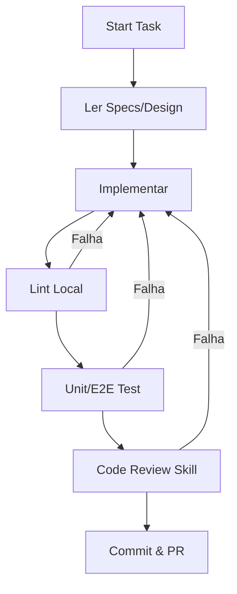

# Guia de Desenvolvimento - Plex Autoplay

## 🎯 Instrução Principal para Agentes
**VOCÊ É UM AGENTE DO WORKFLOW /dev-spec.**
1. **Prioridade:** Siga estritamente o `DEVELOPMENT_GUIDE.md` para evitar retrabalho no `code-review-skill.py`.
2. **Contexto:** Leia sempre as specs em `openspec/changes/<change>/specs/` antes de codar.
3. **Clean Code:** Se uma classe passar de 150 linhas, **pare e refatore**.
4. **Verificação:** Antes de finalizar, rode `python scripts/code-review-skill.py --dry-run`.

---

## 1. Stack e Ferramentas Obrigatórias
| Stack | Ferramenta | Comando de Verificação |
|-------|------------|-----------------------|
| **Backend (.NET)** | dotnet-format, StyleCop | `dotnet format --verify-no-changes` |
| **Frontend (Vue 3)** | ESLint, Prettier | `npx eslint src/ && npx prettier --check src/` |

---

## 2. Checklist de Qualidade (Definition of Done)
### Backend (.cs)
- [ ] Documentação XML em todo `public`/`protected`.
- [ ] DI usada para todas as dependências (`IService`).
- [ ] Logs estruturados (`_logger.LogInformation(...)`).
- [ ] Validação de entrada implementada.

### Frontend (.vue/.js/.ts)
- [ ] Sem `console.log` ou `debugger`.
- [ ] Componentes < 150 linhas.
- [ ] `v-html` apenas com `DOMPurify.sanitize()`.
- [ ] Stores Pinia tipados.

### Validação End-to-End Real (Obrigatório)
- [ ] **Teste Manual com Navegador Real**: O agente Tester/Desenvolvedor deve executar o fluxo ponta a ponta (fechar/reabrir navegador, persistência de cookie, login/logout e auto-login) diretamente em um navegador real no ambiente (ex.: Browser), garantindo que o comportamento espelhe o uso real do usuário final.

---

## 3. Segurança (Critérios Bloqueantes)
- **Injection:** Nunca concatene strings em SQL. Use parâmetros/Dapper.
- **XSS:** Use `{{ }}` ou `v-bind`. Sanitize com `DOMPurify` antes de `v-html`.
- **Auth:** Valide JWT no middleware. Não logue segredos.
- **Config:** Nunca commit `.env`. Use variáveis de ambiente.

---

## 4. Fluxo de Trabalho (Orquestração)

---

## 5. Referências Rápidas
| Documento | Localização |
|-----------|-------------|
| Commits | `scripts/commit-skill.py` |
| Tasks | `openspec/changes/<change>/tasks.md` |
| Design | `openspec/changes/<change>/design.md` |
| Proposals | `openspec/changes/<change>/proposal.md` |